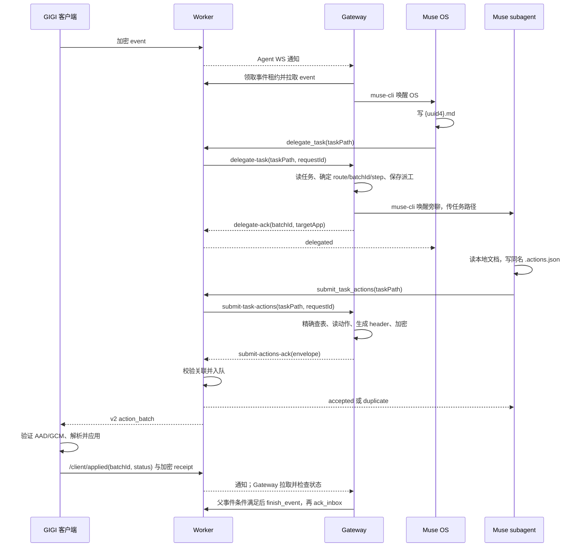

# XPhone 路径交付、动作拼包与事件事务架构

更新时间：2026-11-04。本文描述三个仓库中已写入的代码合同。线上全链路联调由后续测试执行；本文不把本地测试结果当作线上验收。

## 1. 边界与职责

| 组件 | 持有或处理的内容 | 负责的动作 |
| --- | --- | --- |
| Muse OS / subagent | 云电脑上的任务文档、故事资料、纯语义动作文件 | 决定做什么；向 MCP 只交原任务文档的绝对路径 |
| Gateway | 云电脑文件树、`content.key`、事件与派工状态 | 领取事件、派发旁聊、按精确 `taskPath` 查表、拼 header、加密、核对交付状态、结束父事件 |
| Worker | 路径、明文路由 header、密文、派工关联与交付状态 | 通过 Agent WS 转发路径，检查 envelope 格式与已登记派工关联，持久化队列，记录 `applied/rejected` |
| GIGI 客户端 | `content.key`、明文 header、解密后的动作 | 验证 AAD 与 GCM 标签、解析语义目标、应用动作、报告状态并发送回执 |

Worker 没有云电脑文件系统或内容密钥。MCP 的两个路径工具都不接收任务正文或动作正文。header 是可见的路由元数据，可能暴露 App 和角色 surface；故事正文只存在于云电脑和客户端的明文处理边界内。

## 2. 文件合同

首次连接某个 pack 时，Gateway 从 MCP 拉取 manifest、故事文档、运行时资源与动作清单，建立以下文件树。后续旁聊按提示中的本地绝对路径直接读取。

```text
~/xphone/content/{packId}/
├── .manifest.json
├── docs/
├── prompts/
│   ├── tool-reminder.md
│   ├── delegation-inject.md
│   └── app-actions.json
└── {playthroughId}/
    ├── tasks/
    │   ├── delegations/
    │   │   ├── log.jsonl
    │   │   └── {eventId}/
    │   │       ├── {uuid4}.md
    │   │       └── {uuid4}.actions.json
    │   └── events/
    │       └── {eventId}/
    │           ├── {eventId}.md
    │           └── {eventId}.actions.json
    └── memory/
        ├── summary.md
        └── pins.md
```

OS 的派工文档以 `目标: <本轮 delegationTargets 中的完整值>`、`任务: <自然语言任务>` 两行起始。目标是封闭词表，Gateway 逐字匹配；父事件由目录和派工状态确定。Gateway 为 OS 自身回复或 Journal 创建 `tasks/events/{eventId}/{eventId}.md`。两类动作文件都是**非空 JSON 数组**，每项只写语义动作，例如：

```json
[{"type":"messages.append","text":"撤离路线已经确认。"}]
```

模型不构造或抄写 `batchId`、`parentEventId`、`step`、`targetApp`、`surfaceId`、`threadId` 或 `actionId`。路径是交付句柄，仍可能包含 UUID；“模型不接触 ID”指不要求模型填写路由字段。

| 调用方 | MCP 工具 | 唯一参数 | Gateway 查找依据 |
| --- | --- | --- | --- |
| OS 派工 | `xphone.delegate_task` | `{ "taskPath": ".../{uuid4}.md" }` | 当前游玩的父事件和任务文档目标 |
| subagent 提交动作 | `xphone.submit_task_actions` | 同一 `{ "taskPath": ".../{uuid4}.md" }` | `delegations[精确 taskPath]`，动作文件由 `.md` 推导 |
| OS 提交自身回复或 Journal | `xphone.submit_task_actions` | `{ "taskPath": ".../{eventId}.md" }` | `events[eventId]` 和 inbox 事件，动作文件由 `.md` 推导 |

工具的模型可见成功结果只给 `delegated`、`accepted` 或 `duplicate` 状态。`accepted` 仅代表 Worker 入队；客户端 `applied` 才代表完成。目标不在词表、任务不存在、动作文件缺失或格式错误时，MCP 返回可操作的错误文字。

## 3. 调用顺序



OS 自身动作走同一 `submit_task_actions` 提交链，区别是 `origin=event`，批次信息来自事件状态。Journal Phase 1 的动作文件只含一个 `journal.appendMainRecord`，Gateway 从原事件取 `tickId`、`streamId`、`recordId`，先入队一帧 `journal_frame`（`start`、全文），再入队正文动作批次。正文 `applied` 后才进入 Phase 2 派工；Phase 2 没有独立的动作批次。父事件的 step 0 属于 OS，首个派工从 step 1 开始。

## 4. v2 加密 envelope

版本号按 envelope 的 `kind` 检查：`action_batch` 仅接受 v2，没有 v1 兼容入口。`journal_frame` 是先显示 Journal 草稿的独立消息，仍为 version 1；它的 AAD 已绑定 `tickId`、`streamId`、`seq`、`phase`，不承担 action batch 的派工路由。该帧现在由 Gateway 根据事件生成，模型侧的 `submit_journal_stream_frame` 入口已移除。因此保留 frame version 1 不等于保留旧动作批次路径。其他未改造的消息类型也仍为 version 1。

```json
{
  "id": "<batchId>",
  "kind": "action_batch",
  "version": 2,
  "nonce": "<base64url>",
  "ciphertext": "<base64url>",
  "aad": "<base64url>",
  "header": {
    "batchId": "<batchId>",
    "parentEventId": "<eventId>",
    "step": 1,
    "targetApp": "messages",
    "surfaceId": "messages.dm.wan_zhou:role",
    "origin": "delegation"
  }
}
```

`origin` 为 `event` 或 `delegation`。Gateway 使用 `xphone:{packId}:{playthroughId}:{eventId}:{step}` 和 UUIDv5 URL 命名空间确定 `batchId`。`envelope.id` 必须等于 `header.batchId`。普通动作密文解开后形如 `{"actions":[...]}`；Journal 正文还带 `tickId`。路由字段不放进动作正文。

AAD 是按下列键顺序生成的紧凑 UTF-8 JSON，再做无填充 base64url 编码：

```json
{"v":2,"packId":"...","playthroughId":"...","direction":"client","kind":"action_batch","id":"<batchId>","header":{"batchId":"<batchId>","parentEventId":"<eventId>","step":1,"targetApp":"messages","surfaceId":"messages.dm.wan_zhou:role","origin":"delegation"}}
```

Gateway 用 32 字节 `content.key`、随机 12 字节 nonce 和 AES-256-GCM 加密。Worker 重建 AAD 并检查明文格式及派工关联，**不能**校验 GCM 标签；客户端重建 AAD、校验 GCM 标签和批次 UUIDv5 后才应用动作。改动 header 任一字段，即使同时改写 envelope 中的 `aad`，客户端解密仍会失败并报告 `rejected`。

## 5. Gateway 事务状态与重试

Gateway 是事件事务的起始和结束方：它调用 `start_event` 领取租约，负责续租，并在动作及所有相关派工达到完成条件后调用 `finish_event`，随后按 cursor 调用 `ack_inbox`。`delegate-ack` 是旁聊已收到任务，不是父事件完成信号。

| 状态或结果 | Gateway 行为 |
| --- | --- |
| 派工已发送，子批次 `queued/unknown` | 等待 `applied/rejected`；等待不增加 `failures` |
| 全部有效派工 `applied`，或 OS 明确回复“无需联动” | Gateway 完成父事件并 ack；收到回执通知时可在当前有效租约内立即收尾 |
| 派工 `rejected` | Phase 2 提醒 OS 查反馈，为同一目标新建任务；新任务取新步骤，旧任务标为 `superseded` |
| 同一任务文档重复派工 | Gateway 拒绝重复唤醒；已入队动作由稳定 `batchId` 在 Worker 去重 |
| 没有新通知但事件仍待处理 | Gateway 仅在本地 `nextAt` 到期的 WS 空闲节拍重拉 inbox；有效租约尚未过期时将下次检查推至租约到期 |

`muse-dispatch.json` 保存父事件 `events` 与路径索引 `delegations`；`tasks/delegations/log.jsonl` 记录派工的 sent/applied/rejected。Gateway 能根据 step 0 已 `applied` 的 Journal 与现存派工状态恢复进行中的 Phase 2，避免重唤 OS 并撞上任务去重。Worker 在 `delegate-ack` 保存 `taskPath → requestId/batchId/targetApp`，入队及 `/client/applied` 日志按 batchId 串联；关联记录按现有七天保留期清理。

Worker 的 agent inbox 按 cursor 顺序确认。receipt 不能越过更早的未完成事件单独 ack；维护时先检查最早未完成事件及其租约、派工状态。父事件收尾后，积压的 receipt 才能继续按序确认。

## 6. 代码入口与维护边界

| 仓库 | 文件 | 职责 |
| --- | --- | --- |
| `xphone-gateway` | `gateway/gateway.py` | Agent WS 收发、拉取 inbox、到期复查 |
| `xphone-gateway` | `gateway/delegation.py` | 封闭目标词表、精确任务路径索引、动作文件读取、派工结果 |
| `xphone-gateway` | `gateway/submit_actions.py` | v2 action batch 和 Journal frame 加密 |
| `xphone-gateway` | `gateway/muse_context.py`、`gateway/prompts/*`、`gateway/content_cache.py` | 云电脑文件路径、OS/旁聊提示和包级文档树 |
| `xphone-gateway` | `gateway/muse_dispatch.py` | 父事件租约、Journal 两阶段、派工终态检查、finish/ack |
| `xphone-agent-worker-private` | `src/index.ts` | MCP 工具合同与 envelope AAD 格式检查 |
| `xphone-agent-worker-private` | `src/connection.ts` | WS 请求关联、路径到批次索引、持久化队列、回执日志 |
| GIGI | `src/agentruntime/remoteAgentCrypto.ts` | v2 AAD 与 GCM 校验 |
| GIGI | `src/agentruntime/semanticActionTargets.ts`、`remoteAgentRuntime.ts` | header 批次关联、语义路由、应用与回执 |

修改协议时先核对这条调用链及三个仓库的受影响文件，再做最小范围修改。`action_batch` 无旧格式分支；任何 schema 改动都必须同步 Gateway 拼包、Worker 格式检查和 GIGI 解密/路由。部署需要在同一维护窗口协调三端，避免 v2-only 客户端或 Worker 与旧 Gateway 混跑；云电脑 Gateway 由其部署流程拉取代码，本地改动本身不会更新 Muse VM。

本地验证入口：Gateway `python -m unittest discover -s gateway -p 'test_*.py'`（使用仓库虚拟环境）；Worker `npm run typecheck` 与 `npm test`；GIGI `node --experimental-strip-types --test src/agentruntime/semanticActionTargets.test.mjs`。全链路联调仍需在实际新档验证 DM、备忘录、Journal 两阶段、包切换、header 篡改和父事件积压恢复。
