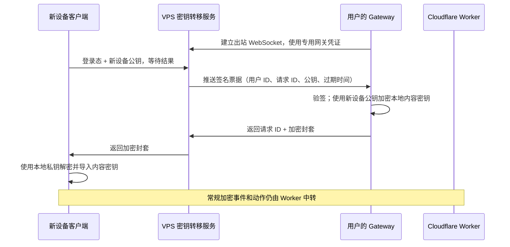

# 将账号密钥转移从 Cloudflare Worker 迁到 VPS

## 目标与边界

把新设备恢复账号内容密钥所需的请求、等待和结果交付放到 VPS。Cloudflare Worker 继续负责客户端与 Agent 之间的加密事件、动作、WebSocket、存档状态和故事资源。VPS 只转发一次性票据及加密后的密钥封套，不接触内容密钥明文。

这份文档是实施计划；目前没有部署迁移。`gateway/gateway.py` 中把密钥转移轮询从 5 秒改成 15 秒的本地修改仍未部署，最终方案会删除这条轮询。

## 当前调用链与成本

1. 客户端向 `gigi-bot` 申请包含新设备公钥、用户 ID、请求 ID 和过期时间的 Ed25519 签名票据。
2. 客户端向 Worker `/account/key-transfer/request` 登记票据，每 2 秒请求 `/account/key-transfer/result`，最多等待 30 秒。
3. 每个常驻 Gateway 独立地向 Worker `/account/key-transfer/pending` 查询；线上采样约每 5 秒一次。Gateway 验签并用新设备公钥加密本地内容密钥，然后调用 `/account/key-transfer/respond`。
4. Worker 的 `pending` 请求先调用账号 DO 检查令牌，再调用同一个 DO 读取队列；一次空查询约产生 1 次 Worker 调用和 2 次 DO 请求。

修复死循环后的采样为每小时 864 次 Worker 调用、约 2,000 次 DO 请求。5 秒空轮询理论上每小时约 720 次 Worker 调用和 1,440 次 DO 请求，是当前固定开销的主要来源。单纯把 Gateway 放到 VPS，若仍请求 Worker，Cloudflare 用量不会消失。

## 目标调用链

服务复用现有 `gigi-bot` 的登录校验、访问资格和票据签名逻辑，运行在 VPS。浏览器发起一次最长 30 秒的请求，服务在内存中等待 Gateway 回复；无需让浏览器反复查询，也无需让 Gateway 空闲轮询。服务重启导致正在等待的请求失败时，客户端重新发起一次恢复请求即可。

## 网关身份与密钥边界

- 新增仅用于 VPS 密钥转移的网关凭证。用户在现有配对页面登录后，`gigi-bot` 生成随机凭证，将凭证摘要与用户 ID 存入现有 Postgres；浏览器把凭证与内容密钥一起加密给 Gateway。现有 Worker 配对环节只传递不透明密文，无需读取其中内容。
- Gateway 在 `~/.config/xphone/` 单独保存该凭证，并用它连接 VPS 的出站 WebSocket。VPS 以凭证对应的用户 ID 路由票据。重新配对时替换旧凭证。现有 Worker 账号令牌继续用于正常 Agent 业务，不交给 VPS 当作密钥转移凭证。
- `gigi-bot` 继续签发恢复票据。Gateway 沿用现有 Ed25519 验签、用户 ID 与过期时间校验，以及 ECDH/AES-GCM 加密；VPS 只看到票据、公钥和加密封套，不保存或记录内容密钥明文。
- VPS 只把一个 Gateway 回复交给对应的已登录请求，按请求 ID 匹配。恢复操作结束后删除内存中的票据与封套；不把它们写入长期数据库或日志。

已有 Gateway 没有新的专用凭证，切换时需要重新配对一次。最终系统不保留 Worker 密钥转移回退路径。

## 实施范围

| 文件或模块 | 所需改动 |
| --- | --- |
| `E:\gigi-bot\src\agent-worker-access.ts`、`src/server.ts` | 提供已登录客户端的恢复请求入口、票据签发、Gateway WebSocket 接入及等待结果；使用现有账号服务校验用户资格。 |
| `E:\gigi-bot\src\account.ts` 与数据库迁移 | 保存用户与专用网关凭证摘要的关系；重新配对时替换凭证。 |
| `E:\GIGI\src\agentruntime\externalAgentMode.ts` | 配对时把专用网关凭证与内容密钥封装在同一份对 Gateway 加密的载荷中。 |
| `E:\GIGI\src\agentruntime\personalAgentAccount.ts` | 恢复时直接向 VPS 服务提交公钥并等待加密封套；删除 Worker 上的 `request/result` 调用及客户端 2 秒轮询。 |
| `gateway/pair.py` | 解开新的配对载荷，分别保存内容密钥、Worker 账号令牌和 VPS 专用凭证。 |
| `gateway/gateway.py`、`gateway/key_transfer.py` | 建立独立的 VPS 出站通知连接；收到票据后沿用现有验签和加密逻辑；删除 `/account/key-transfer/pending` 定时任务及 `/respond` 调用。 |
| `E:\NewProject\xphone-agent-worker\src\index.ts`、`src/connection.ts` | 切换完成后删除四个 `/account/key-transfer/*` 端点、对应 DO 操作、`keytransfer:` 状态与相关 alarm 清理。常规密文中转代码不变。 |

优先沿用 `gigi-bot` 已有的 Postgres、认证和签名能力，不另建一个长期存储服务；VPS 上只增加密钥转移的短时连接与请求处理。

## 切换顺序与验收

1. 在测试环境完成 VPS 服务、专用网关凭证、Gateway 推送连接和客户端一次请求恢复流程。
2. 验证新设备恢复成功，Gateway 离线时 30 秒内明确失败；核对 VPS 日志不含内容密钥、Worker 日志不再出现密钥转移请求。
3. 协调发布客户端和 Gateway，已有 Gateway 重新配对；然后移除 Worker 的旧端点与 DO 状态。完成后不保留双路径。
4. 观察一个无恢复操作的时段：`/account/key-transfer/pending`、`/request`、`/result`、`/respond` 的 Worker 请求均为零；普通客户端 ↔ Agent 加密事件仍可正常送达与确认。

按切换前的 5 秒线上频率，完全迁出后每个当前常驻 Gateway 可消除约 1.6–1.7 万次 Worker 调用/日和 3.2–3.5 万次 DO 请求/日。若先部署了本地 15 秒间隔修改，迁出时再消除约 5,760 次 Worker 调用/日和 11,520 次 DO 请求/日。实际降幅以切换前后相同用户活动条件下的仪表盘数据为准。
